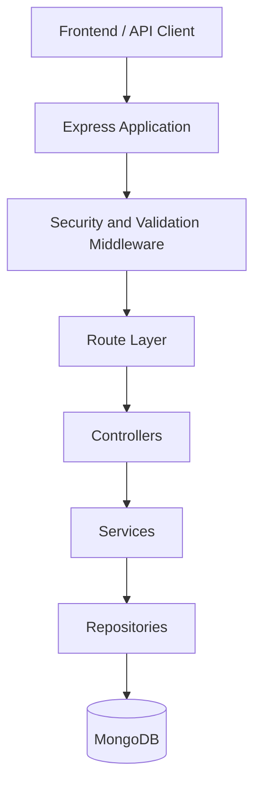

# API Registry

A backend application for organizing API documentation and managing collaborative workspaces.
API Registry allows users to manage workspaces, collaborate through membership and role-based permissions, and upload API specifications in JSON and YAML formats.

## Overview

API Registry is a backend-focused project built to explore the design and implementation of a structured REST API. It emphasizes separation of concerns, authentication, authorization, input validation, error handling, file uploads, API documentation, and automated testing.

The project is designed around a layered architecture that separates HTTP request handling, business logic, and database access.

## Features

- **Authentication:** User authentication with access tokens and refresh-token cookies.
- **Email verification:** Email-based OTP verification with expiration and resend cooldown handling.
- **Workspace management:** Create, list, update, delete, and leave workspaces.
- **Membership and permissions:** Workspace membership management and role-based access control.
- **API documentation uploads:** Upload JSON and YAML API specification files to a workspace.
- **Request validation:** Validate incoming request data before it reaches controllers.
- **Security middleware:** Helmet, CORS configuration, and rate limiting.
- **API documentation:** Swagger-based API documentation.
- **Automated testing:** Jest and Supertest for automated tests, with Postman collections for endpoint and edge-case testing.

## Tech Stack

| Technology | Purpose |
|---|---|
| Node.js | JavaScript runtime |
| Express.js | HTTP server and routing |
| MongoDB | Persistent data storage |
| Mongoose | Data modeling and database operations |
| Jest | Automated testing |
| Supertest | HTTP integration testing |
| Postman | API testing and manual verification |
| Swagger | API documentation |

## System Architecture

API Registry uses a layered backend architecture to separate HTTP concerns, business logic, and data access.



The diagram represents the intended request flow through the application's layers. It should be verified against the actual route and service implementations before final publication.

### Architectural responsibilities

- **Application layer:** Configures Express middleware, API routes, and application-wide behavior.
- **Middleware layer:** Handles cross-cutting concerns such as authentication, authorization, request validation, and rate limiting.
- **Route layer:** Defines endpoints and composes the relevant middleware and controller handlers.
- **Controller layer:** Handles HTTP requests and constructs HTTP responses.
- **Service layer:** Encapsulates business rules and coordinates application operations.
- **Repository layer:** Encapsulates database access and persistence operations.
- **Data layer:** Uses MongoDB and Mongoose to persist application data.

The Express application is separated from the server entry point. The server establishes the MongoDB connection before starting to listen for requests.

### Request lifecycle

A typical request follows this flow:

1. The client sends an HTTP request.
2. Application middleware and route-specific middleware process the request.
3. Validation and access-control checks run where configured.
4. The controller passes the relevant input to the service layer.
5. The service executes business rules and coordinates data access.
6. The repository performs the required database operation.
7. The controller returns the appropriate HTTP response.

Errors are handled through the application's error-handling mechanism.

## Project Structure

API Registry follows a layered architecture that separates HTTP handling, business logic, data access, background processing, and infrastructure configuration.

```text
API-Registry/
├── Config/          # Database, Redis, Cloudinary, mailer, logger, rate limits
├── Controller/      # HTTP request handlers
├── Docs/            # OpenAPI endpoint definitions and reusable schemas
├── Errors/          # Custom application error classes
├── Files/           # File-related storage or resources
├── Jobs/            # Background job definitions
├── Middleware/      # Authentication, authorization, validation, uploads, errors
├── Models/          # Mongoose data models
├── Queues/          # Queue-related modules
├── Repositories/    # Database access and persistence operations
├── Routes/          # Express routes and application configuration
├── Services/        # Business logic and application workflows
├── Tests/           # Unit and integration tests
├── uploads/         # Local upload directory
├── Utils/           # Shared utilities and token/OTP helpers
├── Validators/      # Request validation schemas and rules
└── Worker/          # Background-processing workers
```

### Directory Responsibilities

| Directory | Responsibility |
|---|---|
| `Config/` | Configures infrastructure integrations, including MongoDB, Redis, Cloudinary, email, logging, and rate limiting. |
| `Controller/` | Handles incoming HTTP requests and sends responses. |
| `Docs/` | Contains endpoint-level OpenAPI definitions and reusable documentation schemas. |
| `Errors/` | Defines custom application errors for consistent error handling. |
| `Files/` | Holds file-related resources; its precise purpose depends on its contents. |
| `Jobs/` | Contains modules defining background jobs. |
| `Middleware/` | Handles request processing concerns such as authentication, authorization, validation, uploads, and error handling. |
| `Models/` | Defines Mongoose models and database schemas. |
| `Queues/` | Contains modules responsible for queue-related operations. |
| `Repositories/` | Encapsulates data-access operations and database persistence. |
| `Routes/` | Defines API routes and configures the Express application. |
| `Services/` | Implements business logic and coordinates application operations. |
| `Tests/` | Contains unit and integration tests. |
| `uploads/` | Provides a local upload directory; its role relative to external storage needs verification. |
| `Utils/` | Provides shared helpers for asynchronous execution, files, tokens, and OTP generation. |
| `Validators/` | Defines validation rules for incoming request data. |
| `Worker/` | Contains worker modules for email, file, OTP, and report processing. |


## Authentication and Authorization

The authentication system supports access-token-based authentication and refresh-token handling.

- Access tokens are returned in the login response.
- Refresh tokens are issued through an HTTP-only cookie configured with `Secure` and `SameSite=Strict` attributes.
- Email verification uses OTPs with expiration and resend-cooldown handling.
- Protected routes use authentication middleware.
- Workspace-specific operations apply membership and role checks where required.

Authorization is enforced on the backend rather than relying on the client to restrict access.

## Workspace Management

The workspace module supports the following operations:

| Method | Endpoint | Purpose |
|---|---|---|
| GET | `/workspace/workspacelist/:workspaceId` | Retrieve a workspace by ID |
| GET | `/workspace/workspacelist` | Retrieve the workspace list |
| POST | `/workspace/new` | Create a workspace |
| PATCH | `/workspace/update/:workspaceId` | Update a workspace |
| DELETE | `/workspace/delete/:workspaceId` | Delete a workspace |
| POST | `/workspace/leave/:workspaceId` | Leave a workspace |

Workspace routes use the applicable authentication, validation, membership, and role-checking middleware.

The exact permissions and response contracts for each operation are documented in the API specification.

## API Documentation Management

API Registry supports uploading API specification files in JSON and YAML formats.

- Accepted file extensions: `.json`, `.yaml`, `.yml`
- Accepted MIME types include `application/json`, `application/x-yaml`, and `text/yaml`.
- The upload endpoint uses multipart form data with a single file field named `file`.
- The current upload configuration includes a 5 MB file-size limit.
- Upload requests are associated with a workspace and pass through the relevant workspace and validation middleware.

Further documentation can describe specification parsing, file persistence, validation rules, and file lifecycle behavior as implemented.

## Security and Validation

The application uses several layers of request protection:

- Helmet for HTTP security headers.
- CORS configuration for controlling cross-origin requests.
- Rate limiting to restrict excessive requests.
- Authentication and authorization middleware for protected operations.
- Input validation before controller execution.
- Cookie security attributes for refresh-token handling.
- Centralized error handling for consistent failure responses.

Actual configuration values and endpoint-specific security behavior should be documented alongside the API specification.

## Testing

The project uses a combination of automated tests and API-level verification.

### Automated testing

Jest and Supertest are used to test middleware behavior, including authentication, role-based access, and workspace-related authorization.

The test suite uses mock data and test dependencies where appropriate to isolate behavior and verify expected outcomes.

### API testing

Postman collections are used to exercise endpoint success cases, failure cases, and edge cases across the API.

The Postman collection complements automated tests by making endpoint behavior easy to inspect and reproduce.

### Running tests

The exact commands will be documented from the project's `package.json` scripts.

## Getting Started

### Prerequisites

- Node.js and npm
- MongoDB
- Git

### Installation

```bash
git clone <repository-url>
cd <project-directory>
npm install
```

Configure the required environment variables before starting the server.

## Architecture Decisions and Trade-offs

This section will document the reasoning behind important engineering decisions, including:

- Layered architecture and separation of concerns.
- Repository abstraction and database access.
- Authentication and refresh-token handling.
- Workspace authorization and role enforcement.
- Validation and centralized error handling.
- File-upload restrictions and storage decisions.
- Testing strategy and dependency isolation.

Each decision should describe the reason for the chosen approach, alternatives considered, and relevant trade-offs.

## Limitations and Future Improvements
